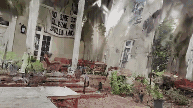

# FLAMBE

My goal with FLAMBE is to have a drone reach the front door of a house it has never seen, using only a forward-facing camera and no GPS. The work is in simulation, in yards reconstructed as 3D Gaussian splats.

## Pipeline

I procedurally generate houses, lots, assets, and materials in Blender, then render the yards and reconstruct them as 3D Gaussian splats. An expert with access to privileged state flies each yard.

I train the camera policy by imitation using DAgger. The expert relabels the states that the student itself visits during training. I then evaluate the policy from fixed sets of starting positions in held-out yards that it never trained on.

## Repository layout

| Directory | Contents |
| --- | --- |
| [`yards/`](yards/) | Blender yard and house generator, including `yardgen/`, `yardgen_v2.py`, `audit_yards.py`, and `preview_sheet.py`. |
| [`expert/`](expert/) | Privileged-state expert and goal specifications. |
| [`policy/`](policy/) | DAgger camera student and expert relabelling. |
| [`eval/`](eval/) | Door-reach and off-axis evaluation, scoring, and the launcher script. |

## Status and dependencies

FLAMBE is an active research project, and the repository contains research-grade code for simulation only. Some helper modules from the full research codebase are not included yet, so the scripts do not run standalone.

Two external dependencies are not included in this repository: the splat simulator [FiGS-Standalone](https://github.com/madang6/FiGS-Standalone) (GPL-3.0) and [SousVide](https://github.com/StanfordMSL/SousVide) (GPL-3.0). Parts of the policy and scoring code build on SousVide's image features and data layout. Point `FLAMBE_TERRA` at the directory containing the `FiGS-Standalone` checkout. The scripts look for the checkout under `$FLAMBE_TERRA/FiGS-Standalone`.

| Variable | Path |
| --- | --- |
| `FLAMBE_ROOT` | FLAMBE repository root. |
| `FLAMBE_YARDS` | Root directory for generated yard data, defaulting to `$FLAMBE_ROOT/synth_yards`. |
| `MARBLE_ASSETS` | Asset directory used by the Blender yard generator, defaulting to `$FLAMBE_ROOT/marble_worlds/assets`. |

## License

[GPL-3.0](LICENSE). The code runs together with two GPL-3.0 projects, FiGS-Standalone and SousVide.
